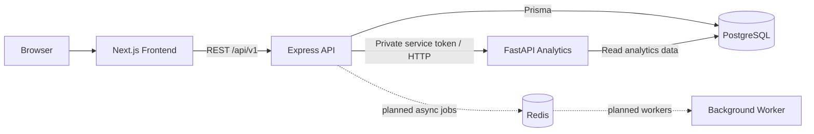

# WorkSphere Architecture

## Service boundaries

## Responsibilities

- **Next.js:** user interface, navigation, forms and client-side session handling.
- **Express:** authentication, authorization, tenant-scoped business operations and primary REST API.
- **PostgreSQL:** authoritative persistent application data.
- **Prisma:** typed database access and migrations.
- **FastAPI:** analytics and export processing.
- **Redis:** provisioned for caching and asynchronous work; a production job/worker workflow must be separately implemented and verified.

## Tenant isolation

Every authenticated business request must derive organization context from the verified session and apply it in server-side database access checks. Never trust a client-supplied organization ID as authorization.

## Current limitations

This diagram describes the current intended architecture and identifies Redis worker processing as planned unless a verified worker implementation exists in the repository. It is not a claim of production deployment.
